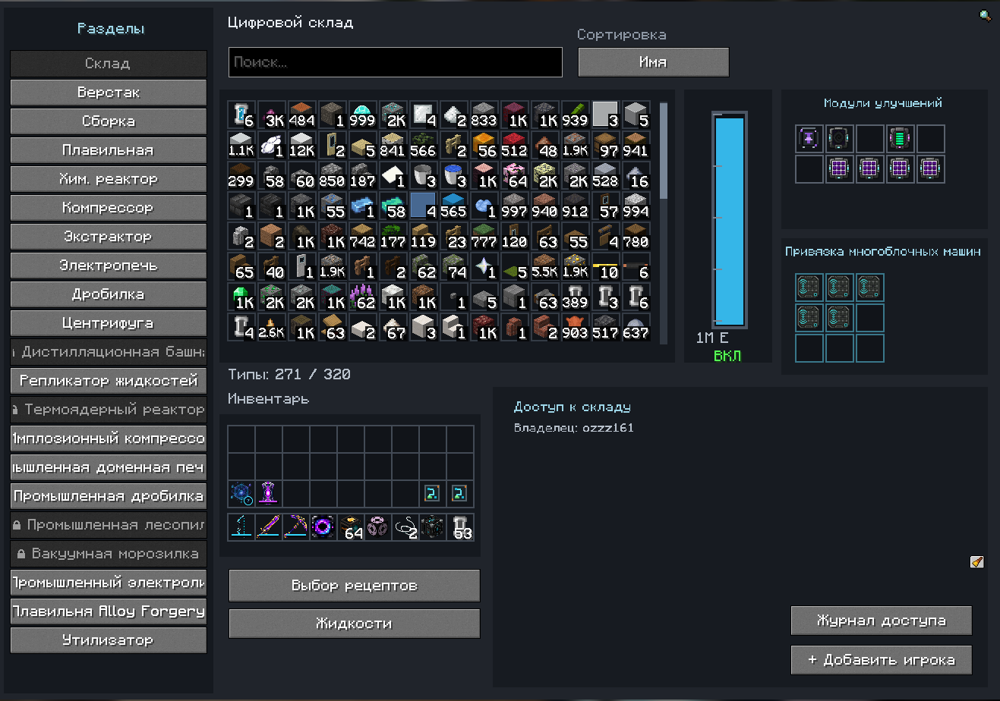
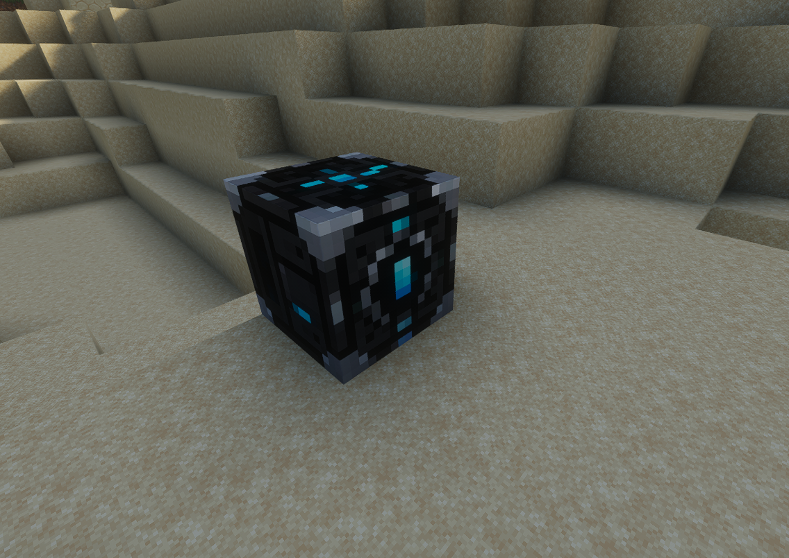
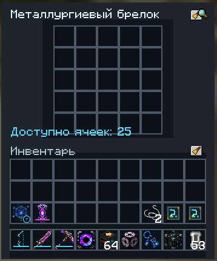
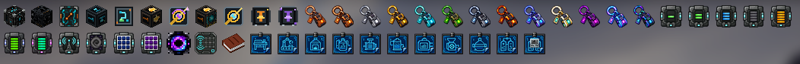
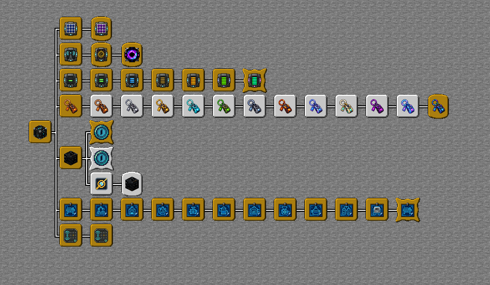
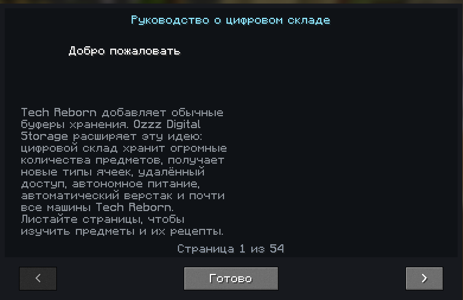
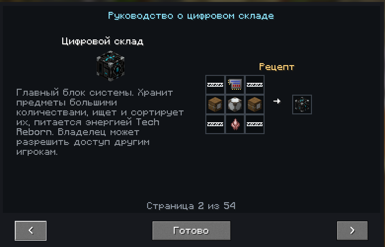

# Ozzz Digital Storage

Цифровой склад, который умеет не только хранить вещи, но и делать из них нужные предметы. Мод для **Minecraft 1.20.4 / Fabric**: с автокрафтом через Tech Reborn, логистикой, механическим истребителем для ферм и строительством по схемам.

Всё началось с одного блока вместо комнаты сундуков. Потом захотелось заказывать готовые вещи, а не бегать между верстаком, дробилкой и печью. Так склад постепенно стал центром базы: он хранит ресурсы, собирает цепочки крафта, снабжает фермы и помогает строить.

## Склад и его улучшения

В одном окне можно искать предметы по названию или идентификатору, сортировать их и забирать нужное количество. Склад считает вещи большими числами, а не обычными стаками. Предметы с разными данными — например, мечи с разными зачарованиями или капсулы с разными жидкостями — хранятся отдельно.

Изначально доступны 64 типа предметов. Семь уровней модулей расширения добавляют ещё 4, 8, 16, 32, 64, 128 или 256 типов на установленный модуль. Есть солнечные модули, два ускорителя верстака и модули удалённого доступа.

Карманная чёрная дыра открывает склад на расстоянии: с обычным модулем — в пределах 100 блоков, с межпространственным — без ограничения расстояния, в том числе из другого измерения. Складам можно давать названия, чтобы не выбирать нужный по координатам.

Склад работает от энергии, совместимой с Tech Reborn. Его внутренний буфер — 1 000 000 E. Жидкости хранятся отдельно от предметов: до 10 вёдер каждого типа. В меню жидкостей можно посмотреть запасы и наполнить капсулы; пустые и заполненные капсулы Tech Reborn складываются по 64.

## Заказать предмет, а не собирать его по частям

Выбираешь результат и количество — склад рассчитывает, что для этого понадобится. Если промежуточных деталей нет, он пробует изготовить их из доступных ресурсов. В интерфейсе видны исходные материалы, этапы и примерное время работы.

Рецепты можно выбирать автоматически или закреплять вручную. Это полезно в сборках, где один предмет получается несколькими способами: склад учитывает выбранный вариант.

Расчёт цепочек выполняется в фоновых потоках. Сам крафт и операции с ресурсами остаются на сервере; материалы для запуска резервируются. Склад выполняет одну основную очередь, а не несколько конкурирующих цепочек одновременно.

Обычные машины добавляются чертежами и получают свои вкладки. Поддерживаются сборочная машина, плавильная, химический реактор, компрессор, экстрактор, электропечь, дробилка, центрифуга, промышленный электролизёр и утилизатор. Для многоблочных машин используются карты привязки к настоящим контроллерам: среди них промышленная доменная печь, промышленная дробилка, лесопилка, дистилляционная башня, репликатор жидкостей, термоядерный реактор, имплозионный компрессор и вакуумная морозилка. При установленном Alloy Forgery доступна и его плавильня.

Ускорители сокращают секундный крафт в верстаке до 0,6 или 0,2 секунды. Установить можно только один: ускорение повышает расход энергии с 50 до 100 или 200 E в секунду. Машины используют время и энергозатраты своих рецептов, а не эти параметры верстака.

Если работа останавливается, запустивший её игрок получает сообщение о причине со звуком. Можно проверить, чего не хватает, и продолжить работу.

## Трубы, приёмщик и экспортёр

Предметы и жидкости можно подавать трубами прямо в склад. Для удалённой точки есть приёмщик: он связывается со складом логистической картой, принимает ресурсы со всех сторон и отправляет их в хранилище. Предмет можно положить и вручную, через его интерфейс.

Экспортёр делает обратное: берёт выбранный предмет со склада и передаёт его в доступное соседнее хранилище. Приёмщик и экспортёр используют одну логистическую карту. Перемещение расходует энергию; если принимающей стороне некуда положить ресурс, передача ограничивается её вместимостью.

Машины могут использовать жидкость из внутреннего резервуара склада вместо подходящих заполненных капсул.

## Механический истребитель

Блок для ферм мобов. Вставляешь оружие, привязываешь склад и включаешь — истребитель атакует мобов перед собой, собирает выпавшие предметы и отправляет их на склад. Игроков и торговцев, включая жителей, он не атакует.

Атака проходит через искусственного игрока, поэтому учитываются оружие и его зачарования. Обычные мечи изнашиваются, электрические заряжаются от буфера истребителя. Починка использует собираемый опыт; оставшийся опыт хранится внутри блока, откуда его можно забрать кнопкой.

Базовая область атаки — 5 блоков в ширину и 5 вперёд. Оптическое улучшение увеличивает область работы. Фильтр на 24 ячейки задаётся отпечатками предметов, не забирая их из инвентаря; при сравнении прочность не учитывается. Доступны белый и чёрный списки.

Работающий истребитель поддерживает загрузку нужных чанков. При этом он не отменяет условия появления мобов: обычным спавнерам и естественному спавну по-прежнему могут требоваться игроки. Блок не освещает ферму, а удар сопровождается отдельной анимацией.

## Брелоки для Gobber 2

Кольца и медальоны не обязательно носить россыпью по всему инвентарю. Брелок хранит их в собственных ячейках и поддерживает их эффекты, пока находится у игрока в инвентаре.

Есть 13 ступеней: от медного на 2 ячейки до металлургиевого на 25. Между ними — бронзовый, железный, золотой, алмазный, гобберовый, вольфрамово-стальной, незерский, мифриловый, из священного сплава, эндерский и целестиаловый. Следующий брелок создаётся из предыдущего; одинаковые кольца или медальоны нельзя дублировать в одном брелоке.

Медальон страданий можно зачаровывать боевыми зачарованиями и использовать как у игрока, в том числе в брелоке, так и в истребителе. В истребителе он атакует чаще меча.

## Проектировщик: строительство из ресурсов склада

Проектировщик загружает схему, показывает цветную полупрозрачную проекцию и строит её перед своей лицевой стороной. Для ресурсов и энергии он подключается к складу логистической картой.

Поддерживаются текстовый SNBT, структуры Minecraft `.nbt`, Sponge `.schem`, старые `.schematic` и `.litematic`. Предельный размер — 128 × 128 × 128 блоков, не больше 32 768 непустых блоков в одной постройке. Совместимость зависит не только от расширения файла: неизвестные блоки пропускаются с предупреждением, а для части блоков из новых версий Minecraft предусмотрены замены.

До старта можно посмотреть список блоков постройки, исходные материалы и нехватку. Проектировщик резервирует ресурсы и может заказать недостающие блоки через автокрафт склада, используя его основную очередь.

Скорость меняется от 1 до 10 блоков в секунду, в том числе во время строительства. Цена одного блока — 100 E, умноженные на выбранную скорость. Есть оставшееся время, пауза, отмена и сброс ещё не начатой либо отменённой схемы. Блоки появляются с анимацией перелёта и звуками строительства.

Если площадка занята, проектировщик предлагает расчистку с подтверждением игрока. Она учитывает и пустоты внутри схемы; добыча отправляется на склад. **Отмена строительства не восстанавливает расчищенный ландшафт.**

Импорт переносит геометрию, но не существ, содержимое контейнеров, команды или таблицы добычи. Сундуки и другие поддерживаемые контейнеры ставятся пустыми. Предусмотрены двери, кровати, горшки с цветами и порядок установки блоков, которым нужны стены, потолок или опора.

## Для совместной игры

Владелец склада может разрешить доступ другим игрокам. Связанные устройства учитывают доступ к складу и права своего владельца.

В журнале видно, кто положил или забрал предметы, что запустил на крафт и что остановил вручную. Там же записываются поступления и экспорт через автоматику, включая добычу истребителя. У крафтов отображаются результат, количество и необходимые материалы. Журнал доступен владельцу, обновляется без повторного открытия и хранит последние 500 записей. Одинаковые операции с предметами и автоматикой объединяются в пределах минуты от начала записи.

В игре есть руководство с описаниями и рецептами, а также дерево достижений: от первого склада до старших брелоков и улучшенного истребителя.

Страницы игрового руководства

## Требования и установка

Текущая версия мода — **1.8.8**. Мод устанавливается **и на клиент, и на сервер**.

[Скачать Digital Storage 1.8.8](https://github.com/ozzz161/Ozzz-Digital-Storage/releases/download/v1.8.8/ozzz-digital-storage-1.8.8.jar)

| Компонент | Требование |
| --- | --- |
| Minecraft | 1.20.4 |
| Java | 17 или новее |
| Fabric Loader | 0.15.0 или новее; версия в настройках сборки — 0.15.11 |
| [Fabric API](https://modrinth.com/mod/fabric-api) | Версия для Minecraft 1.20.4; в настройках сборки — 0.97.2+1.20.4 |
| [Tech Reborn](https://modrinth.com/mod/techreborn) | 5.10.3 или новее, совместимая с Minecraft 1.20.4 |
| [Reborn Core](https://modrinth.com/mod/reborncore) | 5.10.3 или новее, совместимая с Minecraft 1.20.4 |
| [Gobber [FABRIC]](https://www.curseforge.com/minecraft/mc-mods/gobber-fabric) | 2.9.9 или новее, совместимая с Minecraft 1.20.4 |

Mythic Metals и Alloy Forgery не обязательны для загрузки самого Digital Storage, но нужны для полного набора интеграций:

- [Mythic Metals](https://modrinth.com/mod/mythicmetals) добавляет материалы для части старших брелоков. Без него соответствующие рецепты не загружаются.
- [Alloy Forgery](https://modrinth.com/mod/alloy-forgery) нужен для подключения его плавильни. Устанавливая дополнительные моды, проверь также их собственные зависимости.

Team Reborn Energy API включён в сборку Digital Storage. Forge и NeoForge не поддерживаются.

Установи Fabric и перечисленные обязательные моды для **1.20.4**, затем положи JAR Digital Storage в папку `mods`. Для сервера повтори установку зависимостей и мода. Клиенту и серверу требуется одинаковая версия Digital Storage — при несовпадении появится сообщение с нужной версией.

На создание мода меня вдохновила МЭ-система из Applied Energistics 2. Захотелось сделать свой вариант цифрового хранения — с привычными машинами Tech Reborn и возможностями, которые пригодились бы на нашей базе.
